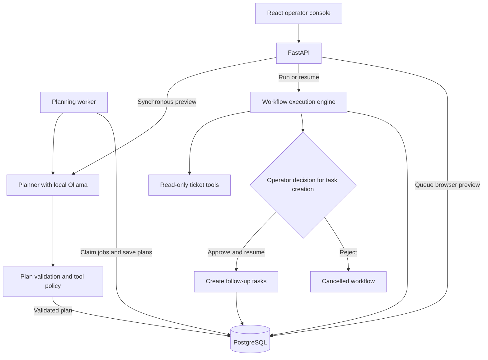

# Axon

**A local-first AI workflow engine with validated plans, operator approval, and recoverable execution.**

Axon turns a natural-language support request into a structured workflow. A local Ollama model identifies the requested action and ticket limit. Axon builds and validates the plan, then runs registered tools under execution policies. PostgreSQL stores workflow state, step results, and event history.

[Try the demo](#demo) · [Run locally](#run-locally) · [Architecture](#architecture) · [Reliability and evaluation](#reliability-and-evaluation)


## Demo

> Create a follow-up task for each of the three most urgent tickets.

1. Open **Workflows**, paste the sample request, and select **Create workflow**.
2. Select **Preview plan** to inspect the validated tool order, dependencies, and the step that writes data.
3. Select **Run workflow**. Axon lists and summarizes the tickets and pauses before writing the follow-up tasks.
4. Open **Approvals** and select the waiting workflow to open its decision panel. Enter the operator token from `.env` and select **Approve**.
5. Select **Resume workflow**. Check **Workflow results** for one follow-up task each for **T-102**, **T-104**, and **T-101**, and **Event history** for the `COMPLETED` status.

**Executions** lists saved workflows. Select a row to reopen the workflow and its event history. To try the rejection path, run a separate workflow to approval and select **Reject**. It ends in `CANCELLED` with no follow-up tasks.

<details>
<summary>Validated execution plan</summary>


</details>

<details>
<summary>Approval queue and operator decision</summary>

The queue and the decision panel show a separate waiting workflow for the same request.


</details>

<details>
<summary>Saved executions and event history</summary>


</details>

The execution tile totals the backend timings for Run and Resume in the current tab and excludes time spent waiting for the operator. Completed step durations are stored with their checkpoints and remain available when reopening a workflow.

## Run locally

Prerequisites are Git, Python 3, Docker with Docker Compose, and enough disk space for the local Ollama model. The initial setup downloads container images and the model. Planning uses the local Ollama service.

From the repository root, generate a private local environment file:

```bash
python3 scripts/init_local_env.py
```

The helper fills the blank fields in `.env.example` with a random database password, a matching `DATABASE_URL`, and a separate operator token. It writes `.env` with owner-only permissions and keeps an existing `.env` unchanged. For an existing setup, check that `AXON_APPROVAL_TOKEN` is set before trying approval. Use its value from your private `.env` in the dashboard's operator decision panel.

The following commands use the Qwen3 4B model from the evaluation. Match the downloaded tag to your planner configuration.

```bash
docker compose --profile local-ai up --wait --wait-timeout 120 db ollama
docker compose exec -T ollama ollama pull qwen3:4b
docker compose build api planning-worker
docker compose run --rm -T --no-deps api alembic upgrade head
docker compose --profile local-ai up --wait --wait-timeout 120 api planning-worker
curl -fsS http://127.0.0.1:8002/health
```

Open [the local dashboard](http://127.0.0.1:8002/dashboard/). In Codespaces, open the forwarded **8002** port, keep it private, and append `/dashboard/` to its URL.

The health endpoint confirms the API is running; it does not preload the model. Initial planning can be slow. Compose requests a configurable 15-minute model residency window to reduce repeated loads between requests; see [model residency and its limits](docs/ollama-model-residency.md).

### Optional monitoring

With the local stack running, start the included Prometheus service:

```bash
docker compose --profile monitoring up -d prometheus
```

Open [Prometheus targets](http://127.0.0.1:9090/targets) and check that `axon-api` and `axon-planning-worker` are **UP**. In Codespaces, forward port **9090** privately. The API and worker expose separate process metrics; Prometheus scrapes both. Stage and tool histograms record latency by outcome.

## Architecture



| Component | Responsibility |
| --- | --- |
| React and TypeScript | Request entry, validated plan preview, execution history, approval queue, and workflow results |
| FastAPI | Workflow API, persisted preview jobs, synchronous previews, and operator decisions |
| Planning worker | Claim queued jobs, retry Ollama timeouts, reclaim interrupted jobs, and save validated plans |
| Ollama | Identify the supported action and ticket count; Axon builds the tool plan |
| Validation and execution | Schema and tool data checks, dependency order, tool policies, retries, and resume from committed steps |
| PostgreSQL and Alembic | Workflow state, planning jobs, step checkpoints and durations, event history, and migrations |
| OpenTelemetry, structured logs, and Prometheus | API/worker request correlation, stage and tool spans, and latency histograms |

The browser starts a preview with `POST /workflows/{id}/plan-job`, receives an acknowledgment, then polls `GET /workflows/{id}/plan-job`. PostgreSQL stores the job; a separate worker generates the plan. The synchronous `POST /workflows/{id}/plan` route serves direct API calls. The evaluation runner supports both paths and defaults to synchronous mode.

## Reliability and evaluation

| Check | Observed result |
| --- | --- |
| Invalid model responses | Integration cases cover malformed JSON, truncated responses, and schema violations. The workflow stays pending and no tool runs |
| Planning recovery | Jobs survive API restarts. Tests cover worker interruption, reclaiming an expired lease, stale-result fencing, timeout retries, and the three-attempt limit |
| Crash recovery | The execution process exited during task creation. Resume reused the first two committed steps |
| Transient and permanent failures | Transient retries used 1, 2, and 4 second delays. A permanent failure stopped after one attempt |
| Concurrent resume | PostgreSQL integration tests confirm one task-creation call, one task per expected ticket, and one completion event |
| Duplicate run | Replaying a separate two-ticket workflow returned HTTP 409 and preserved both follow-up task records |
| Approval replay and access | Tests preserve the original decision and audit history on replay, reject conflicting decisions, and verify access-denial logs without credentials |
| Tool boundaries | Tests cover permission revocation before a write, invalid inputs and outputs, write rollback, and invalid saved checkpoints |
| Planning diagnostics | Both planning endpoints log `planning.failed` with the workflow ID and an error code for timeout, connection failure, or invalid model response |
| Slow browser preview | With a controlled 65-second delay before planning, the initial response returned HTTP 202, polling continued past one minute, and the plan appeared |
| CI | GitHub Actions runs `python -m pytest -q tests`, covering PostgreSQL integration tests and the evaluation runner tests |

### Evaluation results

The following **2026-11-20 Qwen3 4B** results are archived test-set observations. These files have been used during planner development, including those named `holdout`; they now serve as regression sets, not unseen benchmarks.

| Dataset or subset | Planning path | Planner checks, including rejections | Run-state checks passed / attempted |
| --- | --- | --- | --- |
| [Expanded set](evals/planner_holdout_v2.jsonl), 24 cases | Synchronous | 23/24 | 15/15 |
| [Regression set](evals/planner_cases.jsonl), 12 cases | Synchronous | 12/12 | 8/8 |
| [Legacy holdout file](evals/planner_holdout.jsonl), 6 cases | Synchronous | 6/6 | 3/3 |
| [Two-case subset](evals/results/2026-11-20/job-cases.jsonl) | Durable job | 2/2 | 1/1 |

The synchronous suite passed **41/42** cases. One request returned HTTP 502 after about 180 seconds; operator logs identified `ollama_timeout`. The 26 attempted run-state checks passed, but one of the 27 supported cases never reached execution. Seven checks ended at `WAITING_FOR_APPROVAL`; those archived runs did not approve or verify the final task writes.

The separate two-case job run required **zero retries**. It validates that path for those inputs and does not replace the synchronous failure or demonstrate recovery from a live timeout. These reports predate the 15-minute model-residency setting.

See [results, dataset hashes, latency, and measurement limits](docs/planner-evaluation-results.md) and the [unchanged JSON reports](evals/results/2026-11-20/). Earlier reports remain in [the archive](evals/results/).

To evaluate the expanded set through the dashboard's planning path against a running local stack:

```bash
mkdir -p evals/results
report_dir=$(mktemp -d "$PWD/evals/results/planner-job.XXXXXX")
python3 scripts/run_eval.py \
  --base-url http://127.0.0.1:8002 \
  --planning-mode job \
  --dataset evals/planner_holdout_v2.jsonl \
  --output "$report_dir/result.json" \
  --fail-on-regression
```

Use `--planning-mode sync` for a single synchronous call per case. Reports include per-case results, actual HTTP statuses, and planning latency; job reports also retain claim counts and failure codes. The command exits with status 1 if any case fails. See [job evaluation semantics](docs/planning-job-evaluation.md) for wait limits and retry reporting.

To test approval through completion, opt into `--approve-followups` with `AXON_APPROVAL_TOKEN` in the evaluator's environment. This checks the approval boundary, resumes execution and verifies the actual persisted task rows through `GET /workflows/{id}/tasks`. Reports distinguish full completion from the default approval-wait scope. See the [three-case completion check](docs/planning-job-evaluation.md#completing-approval-gated-cases); no new result is claimed for it in the archived table above.

## Scope

Axon demonstrates controlled execution with simulated support data. Approval and rejection use a shared development token, without per-user identity or role management. Production deployment and multi-user authorization are outside the project's scope.

Only the approval and rejection endpoints require the operator token. Workflow reads, creation, planning, and Run/Resume are unauthenticated. Keep the services on localhost and Codespaces forwarded ports private; the shared token does not provide authorization for the whole API.

Browser plan jobs are queued in PostgreSQL and run by the Compose planning worker. The worker can reclaim an interrupted job after its 210-second lease expires. Each claim has a new token, and only the active claim can save a result. Ollama timeouts are retried in the same job, with up to three total attempts. If the dashboard stops waiting, select **Preview plan** again to check the same job. PostgreSQL persists step checkpoints to support resuming interrupted workflow execution.
