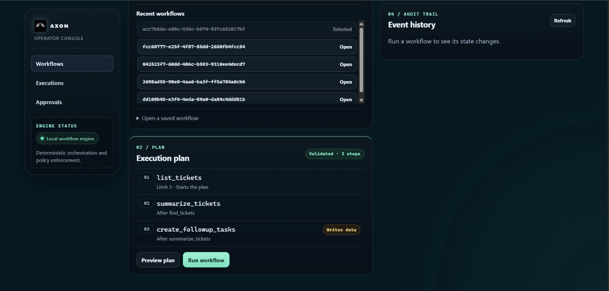
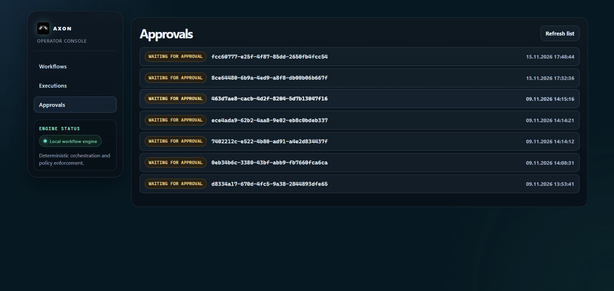
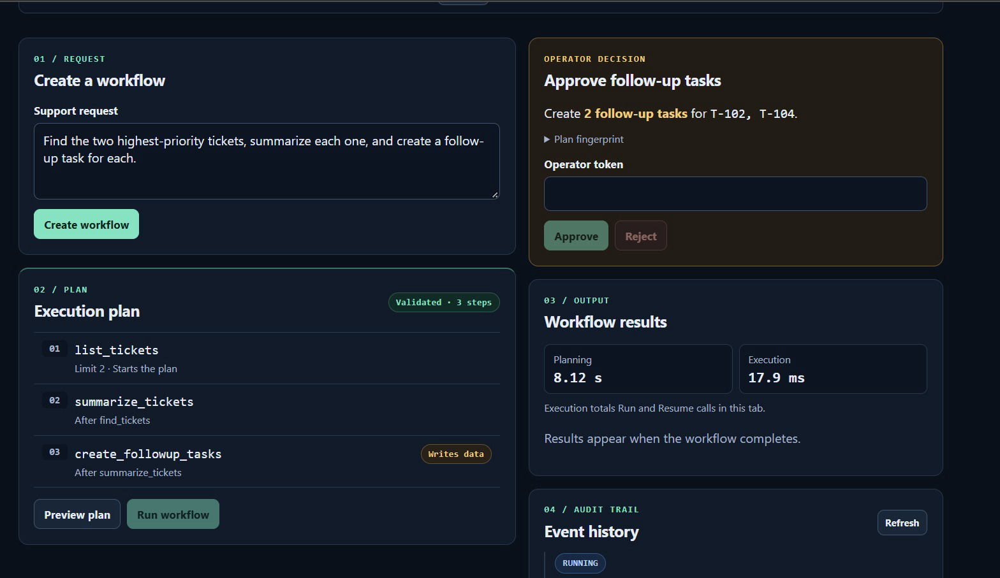
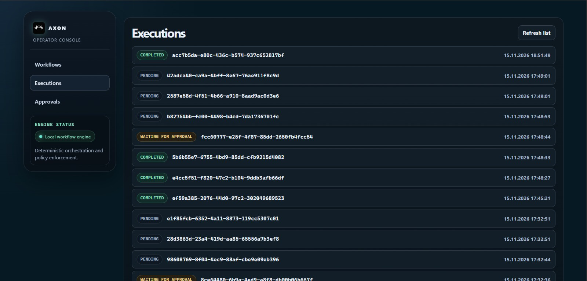
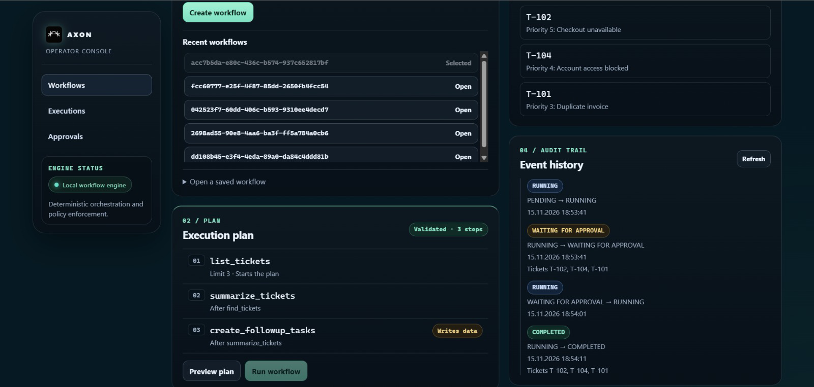
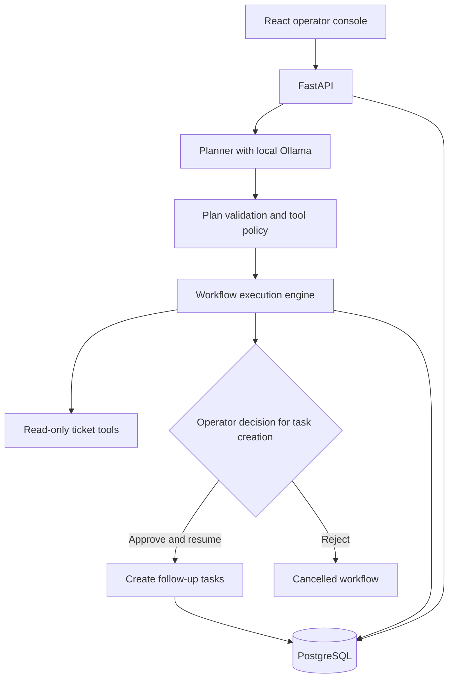

# Axon

**A local-first AI workflow engine with validated plans, operator approval, and recoverable execution.**

Axon turns a natural-language support request into a structured workflow. A local Ollama model identifies the requested action and ticket limit. Axon builds and validates the plan, then runs registered tools under execution policies. PostgreSQL stores workflow state, step results, and event history.

[Try the demo](#demo) · [Run locally](#run-locally) · [Architecture](#architecture) · [Reliability and evaluation](#reliability-and-evaluation)


## Demo

> Create a follow-up task for each of the three most urgent tickets.

1. Open **Workflows**, paste the sample request, and select **Create workflow**.
2. Select **Preview plan** to inspect the validated tool order, dependencies, and the step that writes data.
3. Select **Run workflow**. Axon lists and summarizes the tickets and pauses before writing the follow-up tasks.
4. Open **Approvals** and select the waiting workflow to open its decision panel. Enter the operator token from `.env` and select **Approve**.
5. Select **Resume workflow**. Check **Workflow results** for one follow-up task each for **T-102**, **T-104**, and **T-101**, and **Event history** for the `COMPLETED` status.

**Executions** lists saved workflows. Select a row to reopen the workflow and its event history. To try the rejection path, run a separate workflow to approval and select **Reject**. It ends in `CANCELLED` with no follow-up tasks.

<details>
<summary>Validated execution plan</summary>



</details>

<details>
<summary>Approval queue and operator decision</summary>

The queue and the decision panel show a separate waiting workflow for the same request.





</details>

<details>
<summary>Saved executions and event history</summary>





</details>

The execution tile totals the backend timings for Run and Resume in the current tab and excludes time spent waiting for the operator.

## Run locally

Prerequisites are Git, Docker with Docker Compose, and enough disk space for the local Ollama model. The initial setup downloads container images and the model. Planning uses the local Ollama service.

From the repository root, copy the example environment file.

```bash
test -f .env || cp .env.example .env
```

Set `AXON_APPROVAL_TOKEN` in `.env` to a private development value. The following commands use the Qwen3 4B model from the evaluation. Match the downloaded tag to your planner configuration.

```bash
docker compose up --wait --wait-timeout 120 db ollama
docker compose exec -T ollama ollama pull qwen3:4b
docker compose build api
docker compose run --rm -T --no-deps api alembic upgrade head
docker compose up --wait --wait-timeout 120 api
curl -fsS http://127.0.0.1:8002/health
```

Open [the local dashboard](http://127.0.0.1:8002/dashboard/). In Codespaces, open the forwarded **8002** port, keep it private, and append `/dashboard/` to its URL.

## Architecture



| Component | Responsibility |
| --- | --- |
| React and TypeScript | Request entry, validated plan preview, execution history, approval queue, and workflow results |
| FastAPI | Workflow API, asynchronous browser plan previews, and operator decisions |
| Ollama | Local generation of structured plans for supported requests |
| Validation and execution | Schema checks, dependency order, tool policies, retries, and resume from committed steps |
| PostgreSQL and Alembic | Workflow state, step checkpoints, event history, and migrations |
| OpenTelemetry and structured logs | Trace and request correlation across planning and execution |

The browser starts a preview with `POST /workflows/{id}/plan-job`, receives an acknowledgment, then polls `GET /workflows/{id}/plan-job`. The synchronous `POST /workflows/{id}/plan` route serves direct API calls and the evaluation runner.

## Reliability and evaluation

| Check | Observed result |
| --- | --- |
| Invalid model responses | Six integration cases cover malformed JSON, truncated responses, and schema violations. The workflow stays pending and no tool runs |
| Crash recovery | The execution process exited during task creation. Resume reused the first two committed steps |
| Transient and permanent failures | Transient retries used 1, 2, and 4 second delays. A permanent failure stopped after one attempt |
| Concurrent resume | PostgreSQL integration tests confirm one task-creation call, one task per expected ticket, and one completion event |
| Duplicate run | Replaying a separate two-ticket workflow returned HTTP 409 and preserved both follow-up task records |
| Planning diagnostics | Both planning endpoints log `planning.failed` with the workflow ID and an error code for timeout, connection failure, or invalid model response |
| Slow browser preview | With a controlled 65-second delay before planning, the initial response returned HTTP 202, polling continued past one minute, and the plan appeared |
| CI | PostgreSQL integration tests run in GitHub Actions |

### Evaluation results

These counts describe fixed test sets for supported requests, clarification, and unsupported actions. The [archived reports](evals/results/) record aggregate planner and execution results.

| Metric | Holdout rerun | Archived regression |
| --- | --- | --- |
| Dataset | [planner_holdout.jsonl](evals/planner_holdout.jsonl) | [planner_cases.jsonl](evals/planner_cases.jsonl) |
| Dataset snapshot | [`563ecc2`](https://github.com/KorayAydin3k/Axon/commit/563ecc2) | — |
| Run date | 2026-11-15 | — |
| Total cases | 6 | 12 |
| Planner checks, including expected rejections | 6/6 | 12/12 |
| Exact plan matches on supported requests | 3/3 | — |
| Correct tool selection on supported requests | 3/3 | — |
| Expected rejections | 3/3 | — |
| Successful execution checks | 3/3 | 8/8 |
| End-to-end success on requests expected to execute | 3/3 | — |

The [runner](scripts/run_eval.py) reports tool selection, full plan correctness, and execution separately. Its end-to-end execution rate uses all cases expected to run, including cases blocked at planning. Each execution check verifies the expected workflow state and selected tickets. Approval-gated cases can stop at `WAITING_FOR_APPROVAL`.

Run the holdout evaluation against a running local stack.

```bash
python3 scripts/run_eval.py \
  --base-url http://127.0.0.1:8002 \
  --dataset evals/planner_holdout.jsonl \
  --output /tmp/axon-holdout.json \
  --fail-on-regression
```

The report includes per-case results, HTTP statuses, and plan latency. The command exits with status 1 if any case fails.

## Scope

Axon demonstrates controlled execution with simulated support data. The operator token authorizes approval and rejection in the local demo. Production deployment and multi-user authorization are outside the project's scope.

Browser plan jobs are queued in PostgreSQL and run by the Compose planning worker. The worker can reclaim an interrupted job after its 210-second lease expires. Each claim has a new token, and only the active claim can save a result. Ollama timeouts are retried in the same job, with up to three total attempts. If the dashboard stops waiting, select **Preview plan** again to check the same job. PostgreSQL persists step checkpoints to support resuming interrupted workflow execution.
