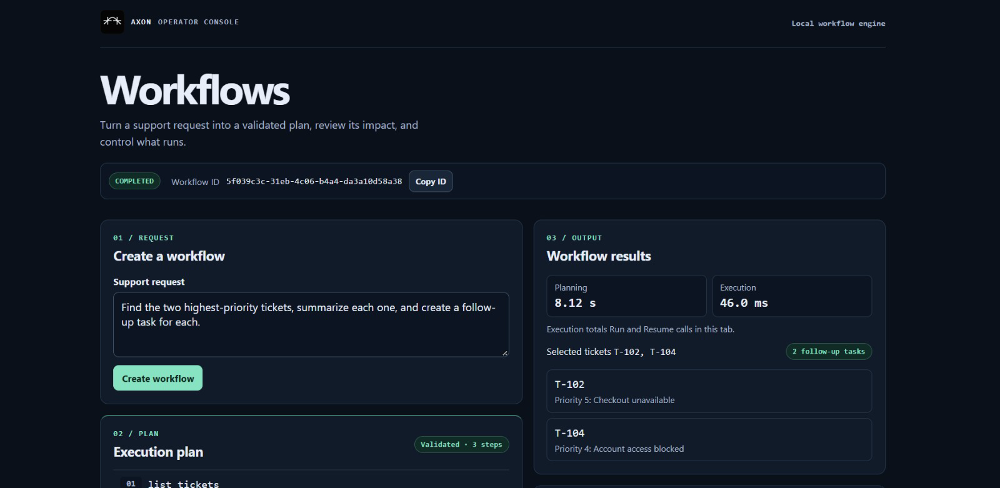
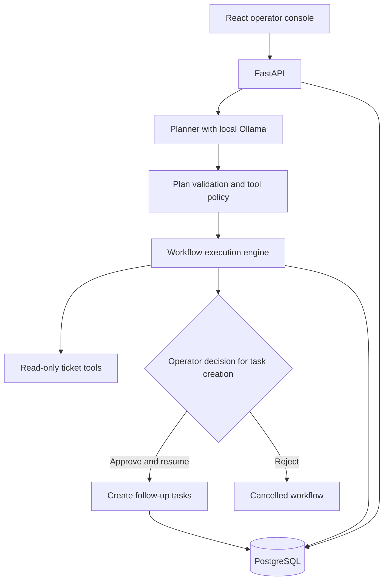

# Axon

**A local-first AI workflow engine with validated plans, operator approval, and recoverable execution.**

Axon turns a natural-language support request into a structured workflow. A local Ollama model proposes the plan. FastAPI validates it, applies execution policies, and runs registered tools. PostgreSQL stores workflow state, step results, and event history.

[Try the demo](#demo) · [Run locally](#run-locally) · [Architecture](#architecture) · [Reliability and evaluation](#reliability-and-evaluation)



## Demo

> Find the two highest-priority tickets, summarize each one, and create a follow-up task for each.

1. Open the dashboard and select **Create workflow** with the sample request.
2. Select **Preview plan** to inspect the validated tool order, dependencies, and the step that writes data.
3. Select **Run workflow**. Axon lists and summarizes the tickets, then pauses before writing the follow-up tasks.
4. Enter the configured operator token and select **Approve**, then **Resume workflow**. The demo run completed with one follow-up task each for **T-102** and **T-104**. On a separate workflow, **Reject** cancels the proposed action.

| Validated execution plan | Operator decision |
| --- | --- |
|  |  |

Screenshots show a real Codespaces run with the built-in support-ticket scenario. That run displayed **8.12 s** of planning and **46.0 ms** of execution. The execution tile totals the backend timings for Run and Resume in the current tab and excludes time spent waiting for the operator.

## Run locally

Prerequisites are Git, Docker with Docker Compose, and enough disk space for the local Ollama model. The initial setup downloads container images and the model. Planning uses the local Ollama service.

From the repository root, copy the example environment file.

```bash
test -f .env || cp .env.example .env
```

Set `AXON_APPROVAL_TOKEN` in `.env` to a private development value. The following commands use the Qwen3 4B model from the evaluation. Match the downloaded tag to your planner configuration.

```bash
docker compose up --wait --wait-timeout 120 db ollama
docker compose exec -T ollama ollama pull qwen3:4b
docker compose build api
docker compose run --rm -T --no-deps api alembic upgrade head
docker compose up --wait --wait-timeout 120 api
curl -fsS http://127.0.0.1:8002/health
```

Open [the local dashboard](http://127.0.0.1:8002/dashboard/). In Codespaces, open the forwarded **8002** port, keep it private, and append `/dashboard/` to its URL.

## Architecture



| Component | Responsibility |
| --- | --- |
| React and TypeScript | Request entry, validated plan preview, approval, output, and event history |
| FastAPI | Workflow API, asynchronous browser plan previews, and operator decisions |
| Ollama | Local generation of structured plans for supported requests |
| Validation and execution | Schema checks, dependency order, tool policies, retries, and resume from committed steps |
| PostgreSQL and Alembic | Workflow state, step checkpoints, event history, and migrations |
| OpenTelemetry and structured logs | Trace and request correlation across planning and execution |

The browser starts a preview with `POST /workflows/{id}/plan-job`, receives an acknowledgment, then polls `GET /workflows/{id}/plan-job`. The synchronous `POST /workflows/{id}/plan` route serves direct API calls and the evaluation runner.

## Reliability and evaluation

| Check | Observed result |
| --- | --- |
| Plan validation | Six malformed plans rejected before any tool call |
| Crash recovery | The execution process exited during task creation. Resume reused the first two committed steps |
| Transient and permanent failures | Transient retries used 1, 2, and 4 second delays. A permanent failure stopped after one attempt |
| Duplicate run | Repeating a completed run returned HTTP 409 and the workflow still had two task records |
| Slow browser preview | With a controlled 65-second delay before planning, the initial response returned HTTP 202, polling continued past one minute, and the plan appeared |
| Planner evaluation | 12 of 12 regression cases and 6 of 6 holdout cases passed |
| Execution evaluation | 8 of 8 regression checks and 3 of 3 holdout checks passed |
| CI | PostgreSQL integration tests run in GitHub Actions |

The evaluation uses fixed expected outcomes for supported requests, clarification, and unsupported actions. The counts describe the supplied test cases. The planner and holdout datasets are in [evals/](evals/), and [the runner](scripts/run_eval.py) records results and plan latency.

## Scope

Axon demonstrates controlled execution with simulated support data. The operator token is a local configuration credential. Browser plan jobs execute inside the API process. Step checkpoints are persisted in PostgreSQL and support resuming interrupted workflow execution.
